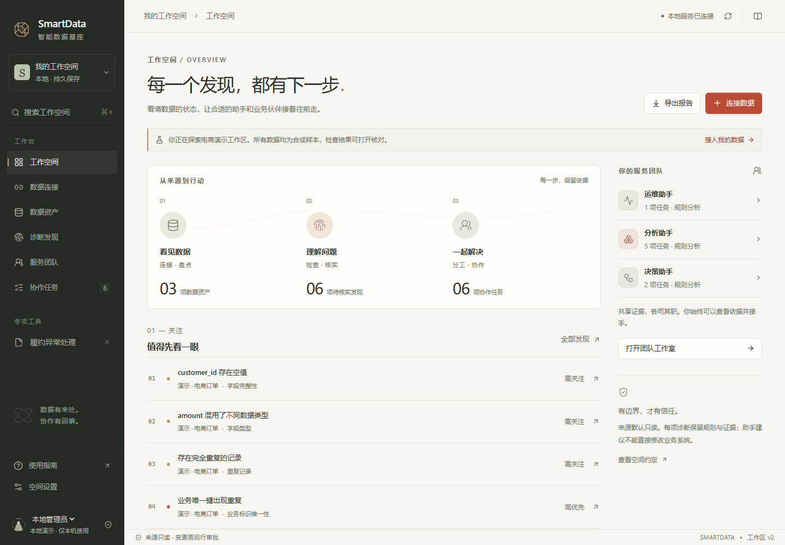

# SmartData · 智能数据基座

让企业看清自己的数据、核实问题，并与运维、分析、决策助手一起推进工作。

SmartData 把连接来源、盘点资产、保留证据、诊断问题、协作任务与结果核验接成一条工作链。当前提供可运行的本机工作空间，以及订单履约的受控执行样板。助手默认使用固定检查规则，也可显式接入模型解释获准证据。企业生产适配与真实业务试点尚未完成，不能把本地演练当作成熟商用或真实收益的证明。

项目背景、重要设计、历史进展和下一步验收统一记录在 **[项目总纲](PROJECT_CHARTER.md)**。它用业务语言解释工作，必要术语附说明；详细目标见[优化路线图](docs/roadmap.md)。



图中为实际运行的合成演示，不代表客户数据。[钛灰主题](docs/images/workspace-titanium.png) · [手机协作界面](docs/images/workspace-team-mobile.png)

## 现在可以做什么

- 连接 JSON 样本、业务 JSON API 和 PostgreSQL 的只读来源。
- 盘点数据资产和字段，检查缺失、重复、类型与更新时间，查看实际观测和样本边界。
- 组织运维、分析和决策三类规则助手，按发现分工、引用证据、讨论、接手和复核任务。
- 可选接入私有服务、火山方舟或百炼的兼容模型接口，保留证据引用、未知项、模型版本和失败记录；具体供应商仍需使用自己的授权实测。
- 在本地保存工作记录，重启继续，导出有依据的报告；演示与用户数据明确分开。
- 用订单履约样板检验“建议 → 策略 → 人工审批 → 防重复执行 → 外部回执 → 独立回读”。
- 选择亚麻朱砂、钛灰古铜、月白水碧主题，使用键盘搜索、数据检查浮层和手机工作台。

## 本机启动

需要 JDK 25、Node.js 24+。Windows 在项目目录运行：

```powershell
.\scripts\start-local.ps1
```

默认打开 `http://127.0.0.1:5173`。首次进入可加载电商演示，或导入自己的脱敏 JSON 样本。脚本说明、真实来源配置和完整操作路径见[上手指南](docs/operations/workspace-quickstart.md)。

手动启动：

```powershell
.\gradlew.bat :runtime-api:bootRun --args="--spring.profiles.active=local"
# 另开终端
Set-Location console
npm ci
npm run dev
```

停止脚本启动的服务：`./scripts/stop-local.ps1`。来源与记录留在 `.local/workspace`，不会上传 GitHub。`local` 是显式的本机模式，不能作为企业认证配置。

## 工程结构

| 位置 | 职责 |
|---|---|
| `runtime-api/.../workspace` | 本地保存、只读接入、资产体检、规则／模型解释与协作 |
| `foundation-kernel` | 证据、未知与冲突、类型化动作、审批、验证与履约仿真 |
| `workflow-worker` | 可恢复的长流程与审批等待；API 尚未接入其编排 |
| `domain-compiler`、`domain-packs` | 把业务对象、规则和动作说明编译成稳定契约 |
| `console` | React 工作台；通用工作空间与履约专项共用公开 API |
| `mcp-bridge` | 面向模型工具的薄边界，仅查询与创建动作请求，不暴露执行器 |
| `contracts` | REST、事件、连接器协议及其验证工具 |
| `deploy` | Compose、策略与 Helm 部署起点 |

## 验证与边界

```powershell
.\gradlew.bat --no-parallel --max-workers=1 test
Set-Location console
npm test
npm run build
# contracts 目录：npm ci，再 npm run validate
# mcp-bridge 目录：go vet ./...，go test -race ./...
```

本轮成果与验收见[阶段报告](docs/reports/2026-10-25-workspace-delivery.md)，履约样板的历史记录见[实施状态](docs/implementation-status.md)。默认生产模式拒绝在缺少真实存储、身份、权限、模型和连接器适配时启动；生产部署仍须完成[部署门禁](docs/operations/production-deployment.md)。现有数据库结构、消息拓扑和 Helm 文件不代表这些适配器已实现，也未证明计划中的大规模容量。

默认不会调用模型。启用后，用户提问与获准问题摘要会发送到指定端点；连接器原始记录不自动进入提示词，用户也不应在提问中粘贴原始记录或密钥。配置与边界见[模型接入说明](docs/operations/model-reasoning.md)。模型不是授权或验证的权威。重要写操作必须有人审批，超时不确定时先对账，不能盲重试。

## 开源与参考

核心采用 Apache-2.0。参与方式见 [CONTRIBUTING.md](CONTRIBUTING.md)，漏洞报告见 [SECURITY.md](SECURITY.md)。参考来源、版本和采用边界记录在 [research-lock.yaml](research-lock.yaml) 与[一手研究](docs/research/2026-10-25-primary-sources.md)。UI 借鉴记录见[设计参考](docs/research/ui-references.md)。Remotion 仅作为研究参考，其自定义许可代码没有进入运行时。原始思考材料、用户数据、凭据和未审查运行输出保留本地，不属于公开产品仓库。
