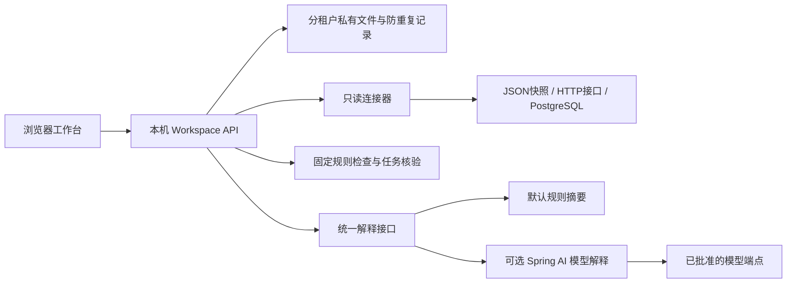

# 0004：企业工作区的本地交付与模型边界

日期：2026-10-25。状态：本地产品采用；生产适配仍需独立验收。

## 为什么增加这层

原履约样板能验证订单异常的受控执行，却缺少普通企业从授权、盘点到协作的入口。
新增工作区先连接只读来源，把实际观察、规则发现和员工任务接起来。它与履约专项
共处一个 API 服务，但两者尚未共享生产数据库和长流程编排，不能宣称已全部打通。

## 当前真正运行的结构

API 是软件接口。Port 是内部接口，使业务服务不直接依赖某家模型。连接器只有
预先写好的读取方式；模型解释接口不注册 SQL、Shell 或其他业务工具。模型输出
不会变成执行命令，任务是否修复仍由新观测与固定验证条件决定。

## 本地保存的选择及退出条件

工作区只在显式 `local` 模式启用，默认监听本机地址。每个租户独立文件，采用
进程内锁、操作系统文件锁、原子替换和持久命令去重。保存前建立私有目录权限，
不能建立时拒绝写入。文件有容量上限，不用于网络共享盘或多机集群。

这让小规模接入和重启恢复可验证，并不替代原计划的 PostgreSQL 事务仓储、
数据库迁移、备份恢复及事件发件箱。发件箱指“状态更新和待发事件一起保存”，
用来避免业务已更新而事件丢失。迁入企业部署前必须实现并验收这些适配器；
不能把本地文件模式换个部署名称直接公开给多用户使用。

## 可选模型的职责和出口

规则负责找线索，模型负责解释获准线索和回答用户问题。默认不联网。启用时必须
批准精确租户和来源，配置端点、密钥引用、时间及用量上限。提问正文也会发送，
界面必须提前说明；当前没有自动识别自由输入中所有敏感内容的能力。

每次调用只携带必要的问题摘要，不自动携带连接器原始记录。响应必须符合规定
格式，引用本次允许的证据，并列出未确认事项。失败保留为失败，不静默降级成
规则答案。引用存在不证明解释正确，仍需业务专家审查。配额在调用前持久预留，
失败不退还；这是防止无限调用的上限控制，不是供应商账单保证。

端点及出口限制是当前本地保护，尚未替代 OPA（集中执行准入规则的策略服务）、
企业数据分类、密钥管理和客户侧 mTLS（双方验证身份的加密连接）。具体参数及
真实供应商验证边界见[模型接入说明](../operations/model-reasoning.md)。

## JSON 依赖的明确例外

业务对象继续使用 Jackson 3.2.1。Spring AI 2.0.1 的官方 OpenAI SDK 内部使用
Jackson 2；两者包名不同，不能把 SDK 所需的旧类强制替成新类。保留这个传输层
依赖并记录精确版本，CI 分别检查依赖、哈希与许可证。业务对象不进入 Jackson 2
序列化路径。后续升级 SDK 时重新审查这个例外，不把“所有依赖已经统一为 3”写成事实。

## 需要的验证

除正常流程，还要拒绝：跨租户凭据复用、断开来源后的新读取、旧证据自证修复、
随机样本冒充完整验证、未批准模型出口、未知证据引用、工具调用、过长或超时响应、
密钥回显以及配额重启绕过。通过本地 HTTP 模型桩，只证明协议与边界行为；
真实火山、百炼和私有部署分别需要契约测试及业务专家评审。
