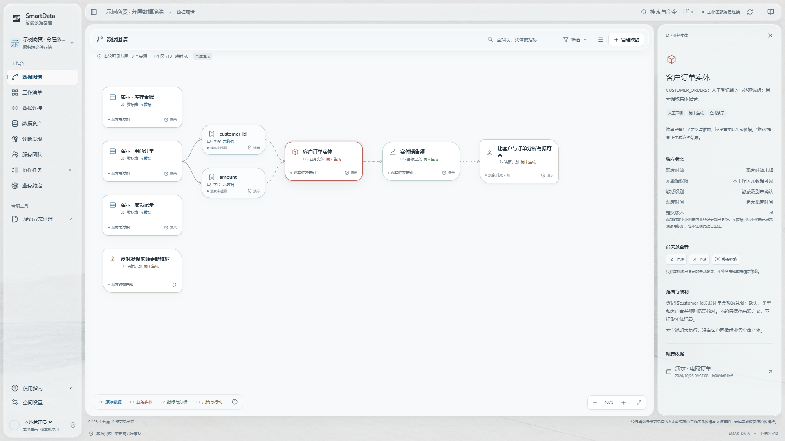

# 阶段汇报：紧凑岛屿工作面与有依据的数据血缘

日期：2026-10-25。本轮按最新反馈撤掉硬分栏和图谱分层竖线，完成紧凑岛屿布局、
自由画布、真实背景折射、原创标识与四套艺术配色。程序与浏览器检查已完成，设计
仍待用户判断；此前硬分栏即使功能测试通过，也不作为视觉终稿。

## 现在可以怎样使用

导航、画布和说明面板各有独立表面，间距约8像素；收起导航后保留52像素工具轨。
默认以清晰字号阅读，平移、缩放或按层级定位；图谱依真实输入关系展开，位置不再
冒充业务层级。没有输入的计划也不会被硬接到数据上。

蓝、朱红、灰绿、古铜表示四层；类型图标与节点形状进一步区分对象。实线、虚线、
点线分别表示观察、声明和计划。选中真实连线时，短光点仅演示方向；减少动画时不播放。
来源结构与未选字段按需展开，覆盖不全会说明，没有补画不存在的聚合关系。

管理员可以登记输入映射，其他身份只读。编辑冲突保留草稿，必须明确重新载入，
不会静默覆盖另一个人的保存。实体和指标仍标“尚未生成”，口径确认不等于算出经营结果。

四套主题为矿白、石墨、水碧和朱砂，色彩来自原创贴图的石墨、普鲁士蓝、矿物色与
纸面质感。标识和类型图标单独编写，没有采用Claude花形标识或其米橙配色。
[石墨效果](../images/workspace-islands-titanium.png) · [朱砂效果](../images/workspace-islands-cinnabar.png) ·
[触屏画布](../images/workspace-islands-mobile.png) · [首次进入](../images/lineage-empty.png)。

## 玻璃效果做到了哪一步

折射会使玻璃边缘背后的线条弯曲，区别于仅把背景模糊。本轮比较了几种开源方案，
最终采用固定版本的小型光学核心，保留完整开源许可证，并加独立适配层。
文字、表单和业务节点保持清晰原位，不为效果截图业务页面。

已在三类真实浏览器内核（负责画出网页的部分）上对比已知图像：只改折射强度，边缘像素改变、中央不变，正文
位置不变。Chromium验证实时背景，Firefox/WebKit验证指定本地图像，不能写成任意业务
页面都能跨浏览器折射。超预算、不支持或要求减少透明度时使用普通表面。
方法与边界见[设计说明](../design/island-canvas-and-liquid-materials.md)及
[像素检查记录](../verification/2026-10-25-material-optics.json)。这不是整页帧率或真实iPhone证明。

## 用什么验证

| 检查 | 实际结果与意义 |
|---|---|
| 界面程序 | 42项测试、前端打包通过；图谱单独按需加载，压缩后约31KB |
| 真实图谱操作 | 桌面、手机、主题、来源展开、实际连线、字段分页、键盘与审计只读通过，版本10前后不变 |
| 映射编辑 | 实际保存、并发冲突、草稿保护、重新载入、新增与删除临时实体通过；原定义恢复，三来源不变 |
| 真实空工作区 | 节点独立空工作区的桌面与触屏检查通过，0个伪造节点，前后版本0；临时服务已清理 |
| 后端与接口 | 节点131项后端回归通过，其中7项覆盖新血缘；三种实际响应通过协议与关系检查 |
| 保存与重启 | 节点真实接口检查后停止并重启进程，版本15、映射、四版约定与审计均保持 |
| 数据库镜像 | 节点实际交付镜像的高危/严重问题27→0，同一镜像20项数据库回归通过，未增加忽略项 |

中途SSH（远端加密连接）转发被重置，界面如实显示失败，并修正了“旧说明面板不能冒充当前观察”的边界。
通过本次连接单独使用Tailscale代理恢复后完成复验，没有更改VPN、全局路由或节点数据。
一次手机检查使用了不真实的零时长手势，改为连续手指轨迹后通过；没有用额外点击事件
掩盖测试问题。失败与恢复记录保留，不据此宣称生产时延达标。

本轮提交的[云端检查与原始报告](https://github.com/Findddx/smartdata/actions/workflows/ci.yml?query=branch%3Amain)
按提交独立保存；节点与历史结果不能替代当前云端结果。

## 节点数据实验与产品画布分别记账

指定节点已实际生成25万合成订单和1万合成客户：客户汇总是一条支路，日指标直接由
原始订单生成，再形成28条核查候选。另一个程序逐客户、逐日、逐计划复算一致，数据库
引擎还独立核对三段查询真正读取的表和列，没有补画“客户汇总→日指标”。

计算使用节点的通用处理器，不冒称显卡加速或真实企业收益。原始记录与数据库留在节点，公开仓库
只保留脚本、审查后的清单、汇总与文件指纹。实验产物没有自动导入工作台，不能替画布
上“尚未生成”的定义背书。见[实验与复现](../../experiments/lineage/README.md)、
[血缘验收](../verification/2026-10-25-lineage-release.md)、
[数据库镜像验收](../verification/2026-10-25-postgresql-image-hardening.md)。

## 长期协作与下一步

[项目总纲](../../PROJECT_CHARTER.md)管理背景、设计、历史和证据导航。个人工作信息、
用户任务清单、学习清单保存在本地私有目录：资源只记名字与用途，任务供用户回填，
深入学习另建文章链接。AI接手先读这些入口；设计未验收前保留参考仓库，不提前固化技能。

这版可以验收新界面、元数据关系与本地协作行为。成熟企业应用还需要正式身份与授权、
真实业务接入、产物导入、完整生产装配和容量实测。下一步按[路线图](../roadmap.md)
推进，不能拿合成演示或组件测试替代真实企业的业务复核。
